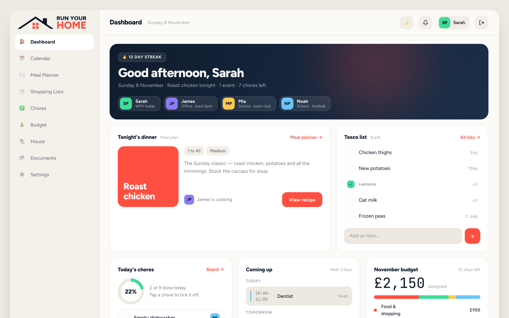
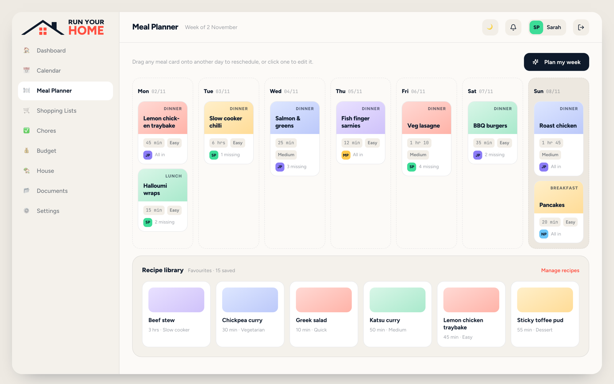
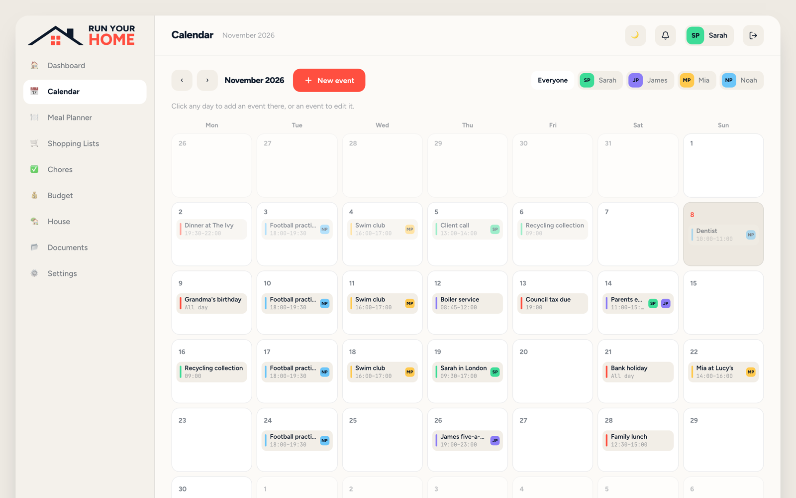
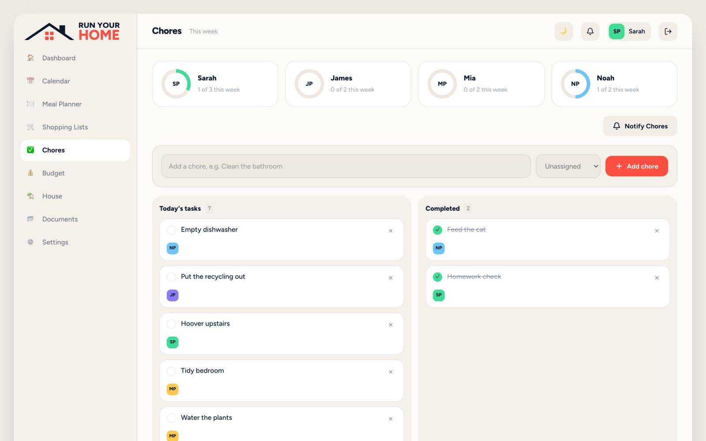
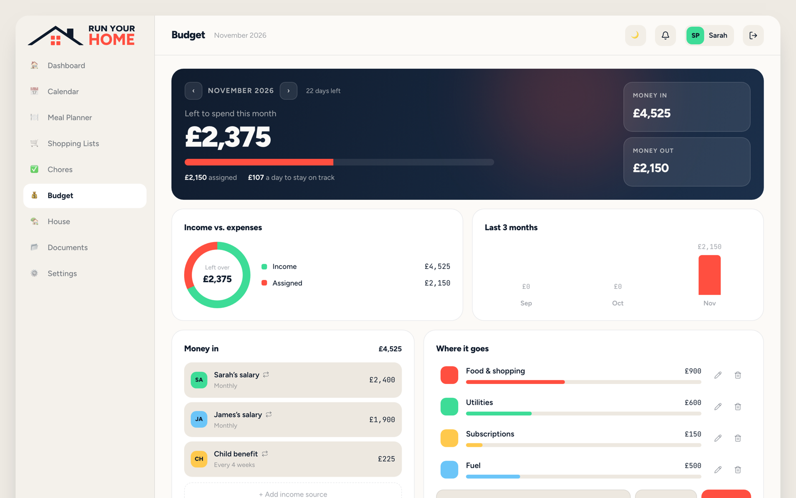
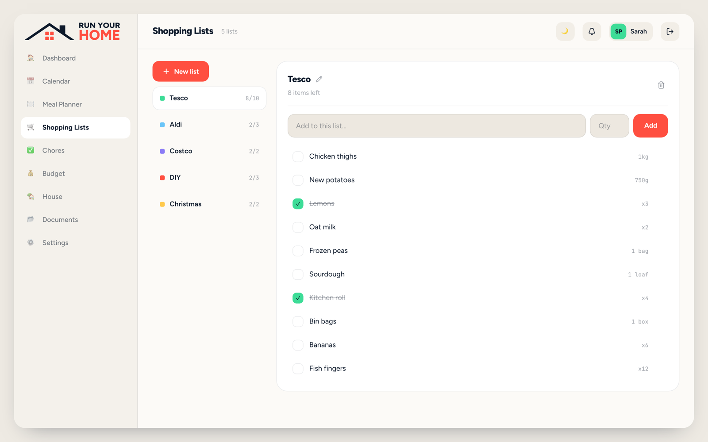

# RYH

[](https://github.com/owensanders/ryh/actions/workflows/tests.yml)
[](https://github.com/owensanders/ryh/actions/workflows/lint.yml)

Family home organiser — dashboard, meal planner, shopping lists, chores,
shared calendar, budget and a document vault, with live in-app notifications.
A Laravel 12 + Inertia 3 + Vue 3 (TypeScript) + Tailwind app, running under Laravel Sail.

| Dashboard | Meal planner |
|---|---|
|  |  |
| **Calendar** | **Chores** |
|  |  |
| **Budget** | **Shopping lists** |
|  |  |


RYH is for UK households, by design: dates are written the UK way (en-GB),
money is in pounds (£), and AI meal plans are costed at UK supermarket prices.
There's no language, currency or date-format setting. Each household still
has its own time zone, so a household living abroad sees its own day.

## Features

- **Dashboard** — daily overview across the household, with each person's
  sign-in streak.
- **Meal planner & recipes** — a weekly planner with an AI-generated plan
  option (via `laravel/ai`, written in the background and kept until it's
  seen), a recipe library, and one-tap "add ingredients to a shopping list".
- **Shopping lists** — multiple named lists per household.
- **Chores** — a Today/Completed board with assignment, and a "Notify
  Chores" reminder button (rate-limited per household).
- **Calendar** — shared events with per-attendee assignment, or whole-house
  events with no attendee list.
- **Budget** — income sources and spending categories; recurring ones carry
  into each new month.
- **Documents** — a folder-based vault for household files.
- **Live notifications** — a bell in the header shows assignment, edit and
  delete activity on chores, calendar events and meals in real time via
  Laravel Reverb (WebSockets), backed by Laravel's database notifications.
- **Push notifications** — the same notifications as Web Push to any device
  someone turns on in Settings → Notifications (on iOS, only in the installed
  app), with a per-category opt-out (chores, calendar, meals). Pushes go out
  through the queue (`ryh-queue`); signing out turns push off for that
  device.
- **Installable app** — a PWA: add RYH to a phone's home screen (an
  install card offers it on Android and walks iOS users through "Add to Home
  Screen"). `public/sw.js` is registered in production builds only and shows
  `public/offline.html` when there's no connection.
- **Households** — multiple households per login, role-based access (Owner,
  Adult, Teen, Child), invites and join codes, and a time zone each.
- **Billing** — Stripe-backed subscription (via `laravel/cashier`), billed per
  household: one flat price covers everyone in it, and each extra household a
  person runs has its own subscription. The 30-day free trial is once per
  person; a household without an active subscription or trial is routed to
  `/billing/required`.


## Quick start

```bash
./vendor/bin/sail up -d
./vendor/bin/sail artisan migrate --seed
./vendor/bin/sail npm install
./vendor/bin/sail npm run dev
```

Then <http://localhost:8090>, signed in as `sarah@ryh.test` / `password`: the
seeded "Parkers" household, with chores, meals, events and a budget in place.
[docs/development.md](docs/development.md) covers the containers, ports,
optional environment variables and testing on a phone.

## How it's built

- **One Laravel app, typed from end to end.** Inertia pages in Vue 3 and
  TypeScript, with the page types generated from the server's `*Data` classes.
- **Strict layers that the checks enforce.** A write goes through a policy,
  a form request and an action; a page is built by a view model that only
  reads. Custom PHPStan rules and tests fail the build when a query, an
  untyped value or a permission check ends up in the wrong layer.
- **Households kept apart.** Every screen lives under `/h/{household}`, route
  bindings are scoped to it, and anyone outside it gets a 404.
- **Slow things on the queue.** Email, Web Push, live updates over Reverb and
  AI meal plans run after the request commits, so none of them can fail it.
- **Tested in a real browser.** PHPUnit, Vitest and a Playwright suite with
  axe accessibility checks, run in CI on every push.

## Documentation

| | |
|---|---|
| [Architecture](docs/architecture.md) | How a request flows, the design choices and their trade-offs, the browser and the background |
| [Running locally](docs/development.md) | Setup, containers, environment variables, Stripe and testing on a phone |
| [Checks and tests](docs/testing.md) | Every check to run before merging, and the end-to-end suite |
| [If RYH goes live](docs/going-live.md) | What would take it to production |
| [`CLAUDE.md`](CLAUDE.md) | The working conventions: the rules each layer follows |
