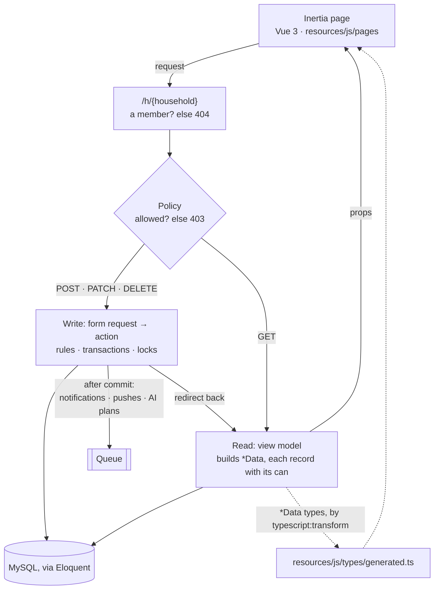
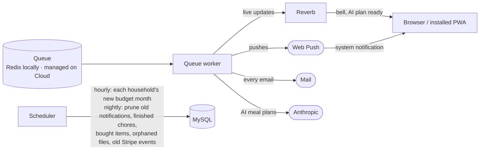

# RYH

Family home organiser — dashboard, meal planner, shopping lists, chores,
shared calendar, budget and a document vault, with live in-app notifications.
A Laravel 12 + Inertia 3 + Vue 3 (TypeScript) + Tailwind app, running under Laravel Sail.

## Features

- **Dashboard** — daily overview across the household, with each person's
  sign-in streak.
- **Meal planner & recipes** — a weekly planner with an AI-generated plan
  option (via `laravel/ai`, written in the background and kept until it's
  seen), a recipe library, and one-tap "add ingredients to a shopping list".
- **Shopping lists** — multiple named lists per household.
- **Chores** — a Today/Completed board with assignment, and a "Notify
  Chores" reminder button (rate-limited per household).
- **Calendar** — shared events with per-attendee assignment, or whole-house
  events with no attendee list.
- **Budget** — income sources and spending categories; recurring ones carry
  into each new month.
- **Documents** — a folder-based vault for household files.
- **Live notifications** — a bell in the header shows assignment, edit and
  delete activity on chores, calendar events and meals in real time via
  Laravel Reverb (WebSockets), backed by Laravel's database notifications.
- **Push notifications** — the same notifications as Web Push to any device
  someone turns on in Settings → Notifications (on iOS, only in the installed
  app), with a per-category opt-out (chores, calendar, meals). Pushes go out
  through the queue (`ryh-queue`); signing out turns push off for that
  device.
- **Installable app** — a PWA: add RYH to a phone's home screen (an
  install card offers it on Android and walks iOS users through "Add to Home
  Screen"). `public/sw.js` is registered in production builds only and shows
  `public/offline.html` when there's no connection. Icons are rendered from
  `public/icons/*.svg` by `node scripts/generate-pwa-icons.mjs`.
- **Households** — multiple households per login, role-based access (Owner,
  Adult, Teen, Child), invites and join codes, and a time zone each.
- **Billing** — Stripe-backed subscription (via `laravel/cashier`), billed per
  household: one flat price covers everyone in it, and each extra household a
  person runs has its own subscription. The 30-day free trial is once per
  person; a household without an active subscription or trial is routed to
  `/billing/required`.

## Running it

```bash
./vendor/bin/sail up -d
./vendor/bin/sail artisan migrate --seed
./vendor/bin/sail npm install
./vendor/bin/sail npm run dev
```

Then <http://localhost:8090>. Sign in as `sarah@ryh.test` / `password`
(also `james@`, `mia@`, `noah@`) — the seeded "Parkers" household, already
subscribed, with chores, meals, calendar events, budget and documents in
place.

`sail up -d` also starts a `ryh-websockets` container (Reverb,
`php artisan reverb:start`) for live notifications — no separate step needed.

Containers: `ryh-app` (PHP app + Vite), `ryh-websockets` (Reverb),
`ryh-queue` (`queue:work`: every email, including verification and password resets, plus live notifications, pushes and AI meal plans), `ryh-scheduler` (`schedule:work`: nightly prunes of old notifications, chores completed over 30 days ago, shopping items ticked off over 7 days ago and document files nothing points to; hourly, each household's recurring budget items into its new month), `ryh-mysql`,
`ryh-redis` (cache, sessions and queue), `ryh-mailpit` (catches all
outgoing mail — inbox at <http://localhost:8025>). The Compose service names
(`laravel.test`, `reverb`, `queue`, `scheduler`, `mysql`, `redis`, `mailpit`) are unchanged — they're the in-network hostnames and
what `sail` commands target.

Ports are shifted off the defaults so they don't clash with the `~/docker`
monorepo's services if both are running: app `8090`, Vite `5174`, MySQL
`3307`, Redis `6380`, Reverb `8080`, Mailpit `1025`/`8025`, e2e server `8091`.

### Optional environment variables

The app runs locally without these, but they gate specific features:

| Var(s) | Feature |
|---|---|
| `STRIPE_KEY`, `STRIPE_SECRET`, `STRIPE_WEBHOOK_SECRET`, `STRIPE_PRICE_HOME_MONTHLY`, `STRIPE_PRICE_HOME_ANNUAL` | Billing/subscriptions — without these, `/billing/subscribe` is disabled |
| `ANTHROPIC_API_KEY` | AI meal plan generation (Claude Haiku 4.5; override with `ANTHROPIC_TEXT_MODEL`) |
| `AI_MEAL_PLAN_DAILY_CAP`, `AI_ALERT_EMAIL` | App-wide daily cap on AI meal plans (default 50), and the address alerted when AI credit runs out — AI pauses itself; `php artisan ai:resume` after topping up |
| `AWS_*` | Document storage on S3 (defaults to the local disk otherwise) |
| `TRUSTED_PROXIES` | Proxies whose `X-Forwarded-*` headers are trusted (`*` or IPs) — needed behind a load balancer, and `*` locally for the phone-testing tunnel |
| `VAPID_PUBLIC_KEY`, `VAPID_PRIVATE_KEY`, `VAPID_SUBJECT` | Push notifications — generate the keys with `sail artisan webpush:vapid`; without them Settings → Notifications says push isn't set up |
| `LEGAL_*`, `SUPPORT_EMAIL`, `PRIVACY_EMAIL` | Business and contact details quoted on `/terms`, `/privacy` and `/support` (`config/legal.php`) — unset ones show as a highlighted "[… to be confirmed]"; fill them all in before launch |

### Testing on a phone

Installing the app and receiving push notifications need HTTPS, so a phone
can't use `http://localhost`. `scripts/tunnel.sh` opens a temporary public
HTTPS address for your local app through a Cloudflare quick tunnel (a
`cloudflared` container: no account or install needed).

1. Add `TRUSTED_PROXIES=*` to `.env` (once), so links through the tunnel come
   out as `https://` on its address.
2. Stop the Vite dev server (`npm run dev`) and run `./vendor/bin/sail npm run build`.
   The phone needs the production build, which also turns the service worker on.
3. `./scripts/tunnel.sh` prints the address. Open it on the phone and sign in.
4. `./scripts/tunnel.sh stop` when you're done, then `sail npm run dev` again.

The address changes every time, and anyone who has it can reach your local app
while the tunnel is open. Live updates (Reverb) don't go through the tunnel, so
the bell only refreshes when a page loads. Push notifications still arrive.

Things to check on the phone:

- **Android (Chrome):** the "Get the RYH app" card installs the app.
- **iPhone (Safari):** the card shows the Add to Home Screen steps.
  Notifications only work from the installed app.
- **Installed app:** after signing out, "Remember me" is already ticked on the
  sign-in form. Coming back after 30+ seconds away shows fresh data.
- **Settings → Notifications:** "Turn on", then "Send a test". Tapping the
  notification opens RYH. Assign yourself a chore from another account:
  the push says who did it, under the household's name.
- **Offline:** with no connection, any page shows "You're offline". It reloads
  by itself when the connection comes back.

## Checks

CI runs all of these on every pull request:

```bash
./vendor/bin/sail artisan test                       # includes the route and naming tests
./vendor/bin/sail bin phpstan analyse                # level 8, plus the layer rules in tests/PHPStan
./vendor/bin/sail bin pint --test
./vendor/bin/sail npm run lint
./vendor/bin/sail npm run format:check
./vendor/bin/sail npx vue-tsc --noEmit
./vendor/bin/sail artisan typescript:transform       # regenerate types after changing app/Data or app/Enums
```

### End-to-end tests

Playwright drives the real UI through the main user journeys (`e2e/*.spec.ts`):
sign-up with email verification, chores, shopping, meals, calendar, roles,
notifications, joining a household, budget and documents, plus a phone-sized
navigation check.

```bash
npx playwright install chromium    # once
npm run e2e                        # or npm run e2e:ui to watch it
```

With Sail up, a run serves the app on <http://localhost:8091> from inside
`ryh-app` with `APP_ENV=e2e` (`.env.e2e`), and rebuilds the separate
`testing_e2e` database from the seeder first, so your dev data is never touched.
Registration links are read from Mailpit, and AI meal planning is a fixed fake
(`App\Ai\Fakes\E2eMealPlanFake`), so no API key or paid call is needed. Journeys
share that one database, so they run one at a time and name what they create
uniquely. CI runs the same
suite in the `e2e` job and uploads the report and traces when it fails.

Run Playwright from your Mac, but install npm packages with `sail npm install`:
`node_modules` is shared with the Linux container, and a host `npm install`
strips the container's native Rollup build, which breaks Vite.

## Architecture

The rules behind this section are in [`CLAUDE.md`](CLAUDE.md). Tests enforce
the ones that can drift, so a change that breaks them fails CI.

### How a request flows

Every household screen lives under `/h/{household}`, so the household a
request acts on is always the one in its URL. Writes go through an action;
pages are built by a view model and only ever read.



The ideas that shape it:

- **The browser never decides who can do what.** Policies answer, and every
  record arrives with its `can` (`chore.can.toggle`), plus `household.can` for
  the nav and "add" controls. The page shows or hides; the server enforces.
- **Types come from the server.** `app/Data` classes are what a page may see,
  and their TypeScript types are generated into `resources/js/types/generated.ts`.
  CI fails if the committed file is out of date.
- **A GET doesn't change household data.** Anything a page needs first runs on
  a schedule or a POST (a budget month's recurring items, for example). The
  only thing a GET records is which household the visitor was last in.
- **Races are closed with the household's row lock.** Member caps, the
  document quota, reminders and AI plans check and write under
  `$household->lockRow()`. Calls to Stripe, mail or the AI happen outside
  the transaction, and notifications go to the queue only once it commits.
  Stripe webhooks are handled once each, however often they're delivered.
- **Each household has a time zone.** Its day turns over at its own midnight
  (`$household->today()`), and event times are stored as its clock reads them.

### In the browser

Pages in `resources/js/pages` declare their props and lay out components from
`components/ryh/<area>/`. Editors that several components share (a calendar's
event dialog and grid, say) live in a composable reached through
provide/inject. Ticks and drags update at once with `useOptimistic()` and
reconcile with the server's answer; writes reload only the props they change
(`only: [...]`). App screens share the persistent `layouts/RyhShell.vue`, and
the design's `--ryh-*` tokens in `resources/css/app.css` cover light and dark.

### In the background

Anything slow or outside our control runs on the queue, so a slow Reverb,
push service, mail provider or AI never fails the user's action:



Notifications go to the recipient's own private channel
(`App.Models.User.{id}`), so nobody receives anyone else's.
