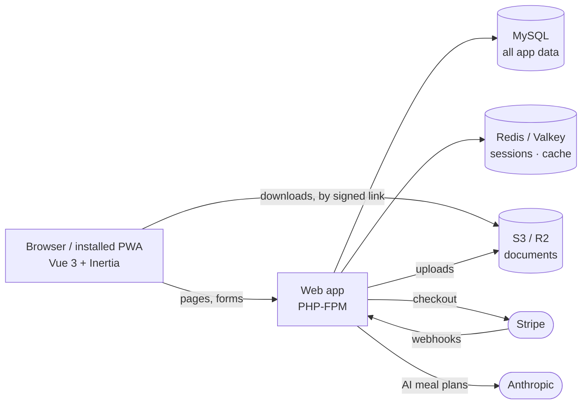
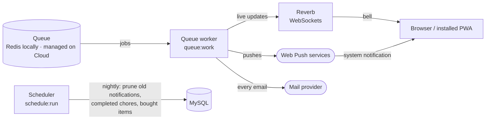
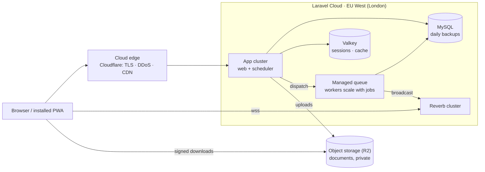
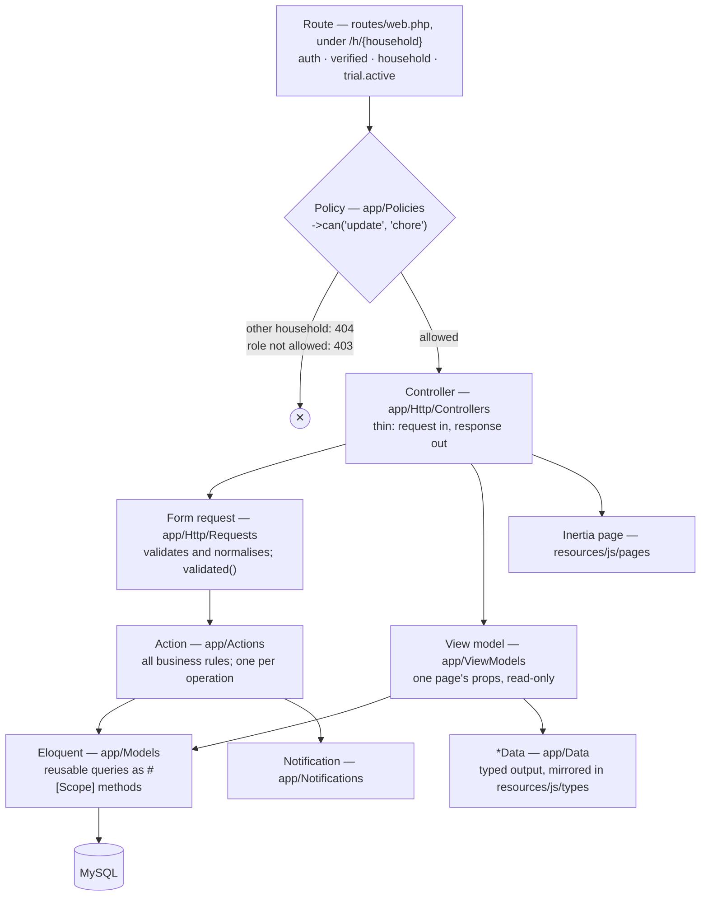
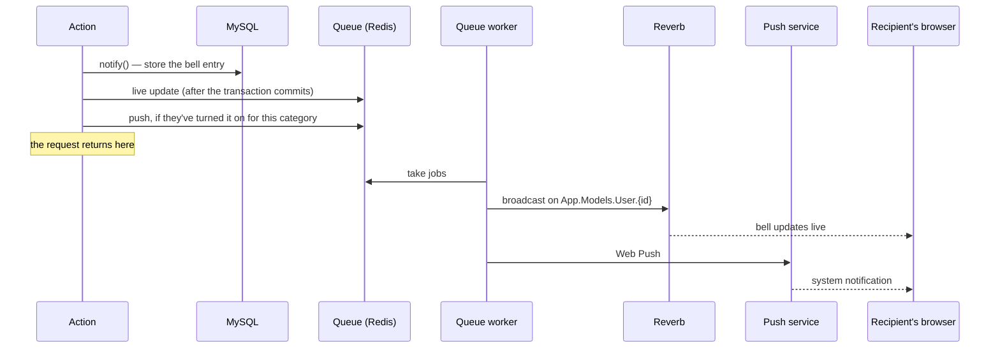

# RYH

Family home organiser — dashboard, meal planner, shopping lists, chores,
shared calendar, budget and a document vault, with live in-app notifications.
Built from the RYH design (`RYH.dc.html`) as a Laravel 12 + Inertia 3
+ Vue 3 (TypeScript) + Tailwind app, running under Laravel Sail.

## Features

- **Dashboard** — daily overview across the household.
- **Meal planner & recipes** — a weekly planner with an AI-generated plan
  option (via `laravel/ai`), a recipe library, and one-tap "add ingredients to
  a shopping list".
- **Shopping lists** — multiple named lists per household.
- **Chores** — a Today/Completed board with assignment, and a "Notify
  Chores" reminder button (rate-limited per household).
- **Calendar** — shared events with per-attendee assignment, or whole-house
  events with no attendee list.
- **Budget** — income sources and spending categories.
- **Documents** — a folder-based vault for household files.
- **Live notifications** — a bell in the header shows assignment, edit and
  delete activity on chores, calendar events and meals in real time via
  Laravel Reverb (WebSockets), backed by Laravel's database notifications.
- **Push notifications** — the same notifications as Web Push to any device
  someone turns on in Settings → Notifications (on iOS, only in the installed
  app), with a per-category opt-out (chores, calendar, meals). Pushes go out
  through the queue (`ryh-queue`); signing out turns push off for that
  device.
- **Installable app** — a PWA: add RYH to a phone's home screen (an
  install card offers it on Android and walks iOS users through "Add to Home
  Screen"). `public/sw.js` is registered in production builds only and shows
  `public/offline.html` when there's no connection. Icons are rendered from
  `public/icons/*.svg` by `node scripts/generate-pwa-icons.mjs`.
- **Households** — multiple households per login, role-based access (Owner,
  Adult, Teen, Child), invites and join codes.
- **Billing** — Stripe-backed subscription (via `laravel/cashier`), billed per
  household: one flat price covers everyone in it, and each extra household a
  person runs has its own subscription. The 30-day free trial is once per
  person; a household without an active subscription or trial is routed to
  `/billing/required`.

## Running it

```bash
./vendor/bin/sail up -d
./vendor/bin/sail artisan migrate --seed
./vendor/bin/sail npm install
./vendor/bin/sail npm run dev
```

Then <http://localhost:8090>. Sign in as `sarah@ryh.test` / `password`
(also `james@`, `mia@`, `noah@`) — the seeded "Parkers" household, already
subscribed, with chores, meals, calendar events, budget and documents in
place.

`sail up -d` also starts a `ryh-websockets` container (Reverb,
`php artisan reverb:start`) for live notifications — no separate step needed.

Containers: `ryh-app` (PHP app + Vite), `ryh-websockets` (Reverb),
`ryh-queue` (`queue:work`: every email, including verification and password resets, plus live notifications and pushes), `ryh-scheduler` (`schedule:work`: nightly prunes of old notifications, chores completed over 30 days ago and shopping items ticked off over 7 days ago), `ryh-mysql`,
`ryh-redis` (cache, sessions and queue), `ryh-mailpit` (catches all
outgoing mail — inbox at <http://localhost:8025>). The Compose service names
(`laravel.test`, `reverb`, `queue`, `scheduler`, `mysql`, `redis`, `mailpit`) are unchanged — they're the in-network hostnames and
what `sail` commands target.

Ports are shifted off the defaults so they don't clash with the `~/docker`
monorepo's services if both are running: app `8090`, Vite `5174`, MySQL
`3307`, Redis `6380`, Reverb `8080`, Mailpit `1025`/`8025`, e2e server `8091`.

### Optional environment variables

The app runs locally without these, but they gate specific features:

| Var(s) | Feature |
|---|---|
| `STRIPE_KEY`, `STRIPE_SECRET`, `STRIPE_WEBHOOK_SECRET`, `STRIPE_PRICE_HOME_MONTHLY`, `STRIPE_PRICE_HOME_ANNUAL` | Billing/subscriptions — without these, `/billing/subscribe` is disabled |
| `ANTHROPIC_API_KEY` | AI meal plan generation (Claude Haiku 4.5; override with `ANTHROPIC_TEXT_MODEL`) |
| `AI_MEAL_PLAN_DAILY_CAP`, `AI_ALERT_EMAIL` | App-wide daily cap on AI meal plans (default 50), and the address alerted when AI credit runs out — AI pauses itself; `php artisan ai:resume` after topping up |
| `AWS_*` | Document storage on S3 (defaults to the local disk otherwise) |
| `TRUSTED_PROXIES` | Proxies whose `X-Forwarded-*` headers are trusted (`*` or IPs) — needed behind a load balancer, and `*` locally for the phone-testing tunnel |
| `VAPID_PUBLIC_KEY`, `VAPID_PRIVATE_KEY`, `VAPID_SUBJECT` | Push notifications — generate the keys with `sail artisan webpush:vapid`; without them Settings → Notifications says push isn't set up |
| `LEGAL_*`, `SUPPORT_EMAIL`, `PRIVACY_EMAIL` | Business and contact details quoted on `/terms`, `/privacy` and `/support` (`config/legal.php`) — unset ones show as a highlighted "[… to be confirmed]"; fill them all in before launch |

### Testing on a phone

Installing the app and receiving push notifications need HTTPS, so a phone
can't use `http://localhost`. `scripts/tunnel.sh` opens a temporary public
HTTPS address for your local app through a Cloudflare quick tunnel (a
`cloudflared` container: no account or install needed).

1. Add `TRUSTED_PROXIES=*` to `.env` (once), so links through the tunnel come
   out as `https://` on its address.
2. Stop the Vite dev server (`npm run dev`) and run `./vendor/bin/sail npm run build`.
   The phone needs the production build, which also turns the service worker on.
3. `./scripts/tunnel.sh` prints the address. Open it on the phone and sign in.
4. `./scripts/tunnel.sh stop` when you're done, then `sail npm run dev` again.

The address changes every time, and anyone who has it can reach your local app
while the tunnel is open. Live updates (Reverb) don't go through the tunnel, so
the bell only refreshes when a page loads. Push notifications still arrive.

Things to check on the phone:

- **Android (Chrome):** the "Get the RYH app" card installs the app.
- **iPhone (Safari):** the card shows the Add to Home Screen steps.
  Notifications only work from the installed app.
- **Installed app:** after signing out, "Remember me" is already ticked on the
  sign-in form. Coming back after 30+ seconds away shows fresh data.
- **Settings → Notifications:** "Turn on", then "Send a test". Tapping the
  notification opens RYH. Assign yourself a chore from another account:
  the push says who did it, under the household's name.
- **Offline:** with no connection, any page shows "You're offline". It reloads
  by itself when the connection comes back.

## Checks

```bash
./vendor/bin/sail artisan test
./vendor/bin/sail bin phpstan analyse                # clean
./vendor/bin/sail npm run lint
./vendor/bin/sail npx vue-tsc --noEmit               # clean; CI checks it too
```

### End-to-end tests

Playwright drives the real UI through the main user journeys (`e2e/*.spec.ts`):
sign-up with email verification, chores, shopping, meals, calendar, roles,
notifications, joining a household, budget and documents, plus a phone-sized
navigation check.

```bash
npx playwright install chromium    # once
npm run e2e                        # or npm run e2e:ui to watch it
```

With Sail up, a run serves the app on <http://localhost:8091> from inside
`ryh-app` with `APP_ENV=e2e` (`.env.e2e`), and rebuilds the separate
`testing_e2e` database from the seeder first, so your dev data is never touched.
Registration links are read from Mailpit, and AI meal planning is a fixed fake
(`App\Ai\Fakes\E2eMealPlanFake`), so no API key or paid call is needed. Journeys
share that one database, so they run one at a time and name what they create
uniquely. CI runs the same
suite in the `e2e` job and uploads the report and traces when it fails.

Run Playwright from your Mac, but install npm packages with `sail npm install`:
`node_modules` is shared with the Linux container, and a host `npm install`
strips the container's native Rollup build, which breaks Vite.

## Architecture

The rules behind this section are in [`CLAUDE.md`](CLAUDE.md). Tests enforce
the ones that can drift, so a change that breaks them fails CI.

### The moving parts

During a request, the web app talks to storage and to the two third parties
whose answer the user is waiting for:



Everything else happens in the background, so a slow or unavailable Reverb,
push service or mail provider delays a notification but never fails the
user's action:



### Where it runs

Production is on [Laravel Cloud](https://laravel.com/cloud), in London.
Each moving part above is a Cloud resource, so there's no server to
maintain. Locally, Sail runs the same parts as containers. Setup and launch
steps are in [`docs/go-live.md`](docs/go-live.md).



| | Locally (Sail) | Production (Laravel Cloud) |
| --- | --- | --- |
| Queue | Redis, `ryh-queue` | Managed queue (`QUEUE_CONNECTION=cloud`) |
| Sessions and cache | Redis | Valkey |
| WebSockets | `ryh-websockets` | Reverb cluster |
| Scheduler | `ryh-scheduler` | Scheduler toggle on the App cluster |
| Documents | local disk | Private R2 bucket (disk `documents`) |
| Mail | Mailpit | Postmark or Resend |

### A request, layer by layer



Each layer only talks to the one below it:

| Layer | Where | Does | Never |
|---|---|---|---|
| Routes | `routes/web.php` | Middleware, and the policy ability for every household route (`->can(...)`). Household screens live under `/h/{household}`; `ResolveHouseholdMiddleware` checks membership (else 404) | Business rules |
| Policies | `app/Policies/*Policy.php` | Is this record in the URL's household (else 404)? Does the role allow it (else 403)? | Writes |
| Controllers | `app/Http/Controllers` | Call actions and view models, render pages, redirect with toasts | Query the database |
| Form requests | `app/Http/Requests` | Validate, and normalise in `prepareForValidation()`; the controller passes `validated()` to the action | Business rules |
| Actions | `app/Actions/<Area>` | Business rules, transactions, sending notifications; one class per operation with `handle()`. Use Eloquent directly. Return `*Data` objects | Pass request arrays straight to the database |
| View models | `app/ViewModels/<Area>` | Build one page's props with `toData()`, returning its `*ScreenData`; Eloquent directly | Write anything |
| Models | `app/Models` | Relations, casts, `#[Scope]` query scopes for queries more than one place needs, small helpers | Business rules |
| Data | `app/Data` | What a page receives (built by view models); mirrored in `resources/js/types/ryh.ts` | Carry models to the page |

### How a notification reaches someone



Notifications go to the recipient's own private channel, so nobody receives
anyone else's. `RecipientsHelper` decides who hears about a change: everyone
involved, each once, never the person who made it.

### Screens

App screens use the persistent `layouts/RyhShell.vue`
(`defineOptions({ layout: RyhShell })`), so the sidebar, header and tab bar
stay mounted between screens. Each screen sets its header title with
`<RyhLayout title subtitle>`.

Design tokens live as `--ryh-*` custom properties in `resources/css/app.css`
and are surfaced as Tailwind `ryh-*` colours. They key off the same `.dark`
class the starter kit's appearance switcher already toggles, so the design's
dark theme comes for free.
