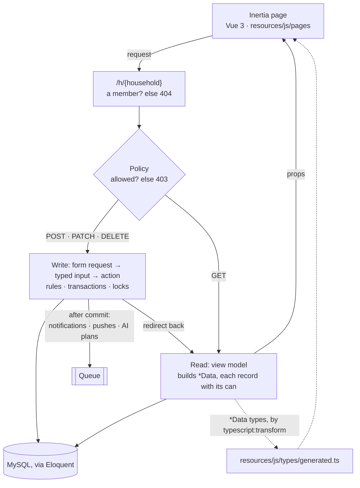
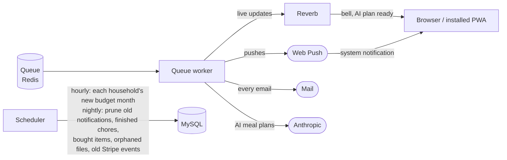

[← README](../README.md)

# Architecture

The rules behind this section are in [`CLAUDE.md`](../CLAUDE.md). Tests and
PHPStan rules enforce the ones that can drift, so a change that breaks them
fails the checks. "Design choices and trade-offs" below says why it's built
this way and what that costs.

## How a request flows

Every household screen lives under `/h/{household}`, so the household a
request acts on is always the one in its URL. Writes go through an action;
pages are built by a view model and only ever read.

The ideas that shape it:

- **The browser never decides who can do what.** Policies answer, and every
  record arrives with its `can` (`chore.can.toggle`), plus `household.can` for
  the nav and "add" controls. The page shows or hides; the server enforces.
- **Types come from the server.** `app/Data` classes are what a page may see,
  and their TypeScript types are generated into `resources/js/types/generated.ts`.
  The checks fail if the committed file is out of date.
- **A GET doesn't change household data.** Anything a page needs first runs on
  a schedule or a POST (a budget month's recurring items, for example).
  CLAUDE.md lists the few exceptions.
- **Races are closed with the household's row lock.** Member caps, the
  document quota, reminders and AI plans check and write under
  `$household->lockRow()`. Calls to Stripe, mail or the AI happen outside
  the transaction, and notifications go to the queue only once it commits.
  Stripe webhooks are handled once each, however often they're delivered.
- **Each household has a time zone.** Its day turns over at its own midnight
  (`$household->today()`). Event times are stored in UTC and shown on its clock.
- **What people type never instructs the AI.** The meal plan form's free text
  is cleaned to short plain lines and sent as JSON data the instructions say
  not to obey (`MealPlanAgent::message()`), and every suggestion is checked
  before it's shown (`MealSuggestionCheckService`): the exact schema, saveable
  lengths, and no links, markup or talk of instructions.

## Design choices and trade-offs

RYH is built for households of a handful of people. The shared database and
the per-household row lock both assume that.

What the design aims for, and what keeps it there:

- **Households kept apart.** The household comes from the URL, route bindings
  are scoped to it, and anyone outside it gets a 404, so a record's existence
  is never confirmed. Guarded by `HouseholdUrlTest`, `CrossHouseholdAccessTest`
  and `RouteAuthorizationTest`.
- **Layers that stay where they are.** PHPStan's rules in `tests/PHPStan`
  (`QueryBoundaryRule`, `TypedActionInputRule`, `TypedRequestValuesRule`,
  `UserFacingErrorsRule`), plus `LayerShapeTest` and `NamingConventionsTest`,
  fail the checks when a query, an untyped value or a raw error message ends up
  in the wrong layer.
- **Pages that cost the same however big the household.** `PageQueryBudgetTest`
  fails when a page's query count grows with its rows. Lazy props and
  `preventLazyLoading()` keep it that way.
- **A slow outside service never fails a request.** Mail, pushes, live updates
  and the AI run on the queue after the transaction commits. Every write route
  is rate limited (`RouteThrottleTest`), and the AI has an app-wide daily cap.
- **Simple to run.** One Laravel app, one MySQL database and Redis, with no
  separate API or rendering server.

What was given up for it:

| Choice | Gains | Costs |
|---|---|---|
| One Laravel app with Inertia pages, and no API | Types from end to end, one deploy, quick to build | A native app or an integration would need an API added first; on phones it's the PWA |
| Strict layers: an action per write, a view model per page, a `*Data` class per output | Each rule lives in one place, and the checks can enforce it | Ceremony: a new form field touches the request, input, action, Data class, view model and generated types |
| Eloquent used directly, with no repositories | Conventional Laravel and less indirection | Business rules are tied to Eloquent, by choice |
| One database for every household, each row carrying its `household_id` | Cheap, with one schema and simple migrations | Isolation comes from code and tests, not the database, so a missed scope could leak |
| Racing checks lock the household's row | Simple and correct, and easy to reason about | Locked writes in one household wait their turn, which is fine for a family but not for a large group |
| A GET never changes household data | Pages are safe to reload, prefetch or have crawled | Some state waits for the scheduler (the budget's new month, hourly), hence "Bring them in now" |
| Side effects go on the queue | A slow push service, mail provider or AI never fails the person's action | Delivery comes a moment later, the workers need supervising, and a failed job goes unseen until error tracking is added |
| Pages get abilities, never the role | The frontend can't drift from the server's rules | Every new control needs a new policy ability |
| UK only | No translation, currency or date-format code to build or test | A smaller market, and costly to reverse: £ and en-GB formatting are written directly |

## In the browser

Pages in `resources/js/pages` declare their props and lay out components
from `components/<area>/`, built from the controls in `components/ui/`.
Editors that several components share (a calendar's event dialog and grid,
say) live in a composable reached through provide/inject. Ticks and drags
update at once with `useOptimistic()` and reconcile with the server's answer;
writes reload only the props they change (`only: [...]`), and props that
query are closures, so the server skips the rest. App screens share the
persistent `layouts/RyhShell.vue`, and the design's `--ryh-*` tokens in
`resources/css/app.css` cover light and dark. The landing and other public
pages send their title, description and preview image in the HTML
(`config/meta.php`), so shared links show a proper preview, and the routes
the browser knows leave out Telescope, Stripe's webhook and the file routes
(`config/ziggy.php`).

## In the background

Anything slow or outside our control runs on the queue, so a slow Reverb,
push service, mail provider or AI never fails the user's action:

Notifications go to the recipient's own private channel
(`App.Models.User.{id}`), so nobody receives anyone else's.
